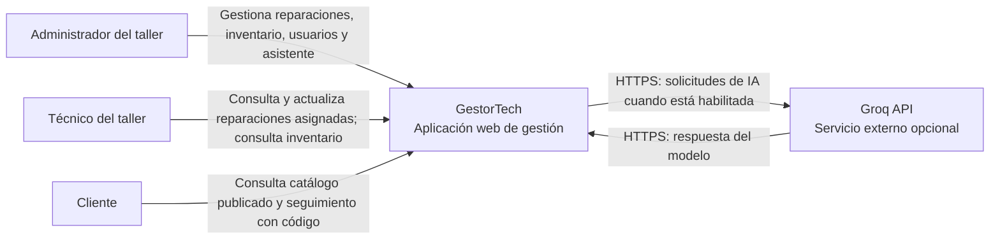
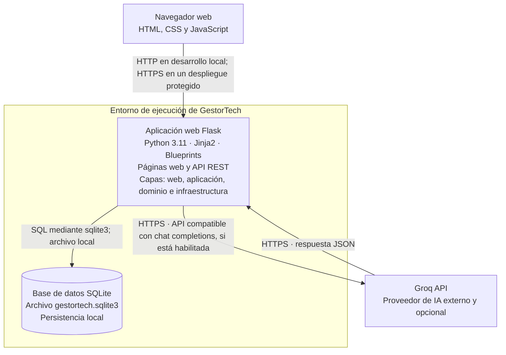

# Arquitectura de GestorTech

**Proyecto:** GestorTech  
**Módulo:** 6 – Proyecto Integrador  
**Sesión:** 2 – Arquitectura y revisión de código con IA  
**Rama de integración:** `develop`
**Estado:** arquitectura de las propuestas integradas localmente al 2026-11-15; pendiente de revisión/merge. Conserva los límites de la arquitectura aprobada.

## 1. Propósito

Este documento describe la arquitectura que existe actualmente en GestorTech mediante dos niveles del modelo C4: contexto y contenedores. Los diagramas se elaboraron contrastando la estructura del repositorio y los componentes de ejecución. No representan funcionalidades futuras como si ya estuvieran implementadas.

## 2. C1 – Diagrama de contexto

GestorTech es una aplicación web para la operación de un taller de servicio técnico. El administrador gestiona usuarios, reparaciones e inventario; el técnico trabaja con las reparaciones que tiene asignadas; el cliente consulta el catálogo público y utiliza el código de seguimiento para consultar el estado y los avances que el taller haya marcado como públicos.

El asistente de IA puede comunicarse con Groq cuando el proveedor está habilitado y configurado. La aplicación conserva un flujo manual cuando el servicio de IA no está disponible.

### Límites del contexto

- El cliente dispone de seguimiento y catálogo públicos. La propuesta #10 incorpora publicación administrativa explícita; no existe autenticación de clientes.
- Groq es una integración opcional; no es necesario para que funcionen las operaciones manuales del sistema.
- Los usuarios acceden mediante un navegador web. No existe una aplicación móvil o un frontend independiente documentado en el código actual.

## 3. C2 – Diagrama de contenedores

El sistema se ejecuta como una aplicación Flask. La misma aplicación entrega las páginas HTML mediante Jinja2 y expone endpoints de API. La lógica está organizada internamente en capas de presentación web, aplicación, dominio e infraestructura.

SQLite es el motor de persistencia actual. En la configuración Docker Compose, el archivo de base de datos se almacena en `/app/instance/gestortech.sqlite3`, dentro de un volumen persistente. Groq se consume por HTTPS desde el adaptador de infraestructura cuando está habilitado.

### Contenedores y responsabilidades

| Elemento | Tecnología | Responsabilidad |
|---|---|---|
| Navegador web | HTML, CSS y JavaScript | Presenta las páginas y permite la interacción de administradores, técnicos y clientes. |
| Aplicación web | Python 3.11, Flask y Jinja2 | Atiende páginas y API, aplica autenticación y autorización, coordina servicios y reglas de negocio. |
| Base de datos | SQLite | Persiste usuarios, reparaciones, historial, productos/publicación, movimientos, presupuestos de intentos y propuestas/auditoría del asistente. |
| Proveedor de IA | Groq API, opcional | Procesa solicitudes del asistente y propuestas de importación cuando está habilitado y configurado. |

## 4. Organización interna de la aplicación

La aplicación Flask mantiene una separación por responsabilidades:

- `app/web/`: Blueprints, autenticación, páginas y endpoints de API.
- `app/application/`: servicios de aplicación, coordinación del asistente y puertos para integraciones.
- `app/domain/`: modelos, estados y reglas del dominio.
- `app/infrastructure/`: conexión y esquema SQLite, además de adaptadores externos como Groq.
- `app/templates/` y `app/static/`: vistas Jinja2, estilos, JavaScript e imágenes.

Esta organización es interna a la aplicación Flask; no significa que cada carpeta sea un servicio o contenedor desplegable independiente.

## 5. Ejecución y persistencia

El proyecto puede ejecutarse localmente con Flask o mediante Docker Compose. La configuración Docker actual publica el servicio en `127.0.0.1:8000` y monta el volumen `gestortech_data` en `/app/instance` para conservar la base de datos SQLite.

La aplicación obtiene la ubicación de la base de datos mediante la variable `GESTORTECH_DATABASE`. La clave de sesión y la configuración opcional de Groq se suministran mediante variables de entorno; las credenciales no deben incluirse en el repositorio.

## 6. Límites y evolución pendiente

- **Base de datos actual:** SQLite. La evaluación de una posible migración a PostgreSQL o MySQL está registrada en el [issue #20](https://github.com/LzMauLz/Proyecto-GestorT/issues/20), con prioridad Should. No se representa como una migración realizada.
- **Catálogo para clientes:** implementado en la propuesta #10 como página pública de la misma aplicación Flask; sin nuevo servicio ni rol de cliente.
- **Integración IA:** Groq continúa siendo opcional y está aislado mediante un adaptador. La propuesta #7 incorpora aclaración, edición y archivos locales. Las pruebas actuales son locales con dobles explícitos; no validan semántica de Groq real.
- **Despliegue:** Docker corresponde a demostración HTTP local. Producción requiere aprobación y evidencia de TLS/proxy, servidor WSGI, retención/cifrado de backups y operación segura. Los límites de intentos SQLite y la utilidad de snapshot no sustituyen esas decisiones.

## 7. Decisiones de arquitectura

Las decisiones de arquitectura solicitadas para esta sesión ya están documentadas en los siguientes registros:

- [ADR-001 – Justificación del lenguaje y framework](adr/ADR-001.md).
- [ADR-002 – Justificación de la base de datos o plataforma de despliegue](adr/ADR-002.md).

## 8. Referencias del repositorio

- [README](../README.md)
- [Estado actual del proyecto](../PROJECT_STATUS.md)
- [Código de inicialización Flask](../app/__init__.py)
- [Persistencia SQLite](../app/infrastructure/database.py)
- [Adaptador Groq](../app/infrastructure/ai/groq_adapter.py)
- [Issue #17 – Arquitectura C4 y ADR](https://github.com/LzMauLz/Proyecto-GestorT/issues/17)
