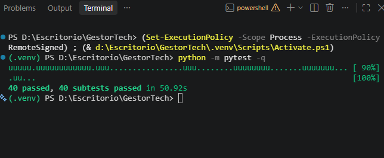
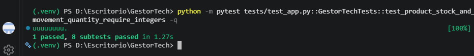

# Evidencias del proyecto GestorTech

Registro acumulativo de pruebas, integración continua y entregas académicas. Se actualizará cuando se incorporen nuevas evidencias verificadas.

## Módulo 6 · Sesión 3: pruebas e integración continua

### Suite local

El 14 de noviembre de 2026 se ejecutó `python -m pytest -q` desde el entorno virtual del proyecto. Resultado reportado en terminal: **40 pruebas aprobadas y 40 subtests aprobados**, en 50,92 segundos.

### Comprobación de mutación

El 15 de noviembre de 2026 se modificó temporalmente `_to_integer` para aceptar booleanos como enteros. La prueba `test_product_stock_and_movement_quantity_require_integers` detectó la regresión: fallaron los dos subtests con `True` (uno para existencias iniciales y otro para movimiento de inventario). Después se restauró la condición original y la misma prueba pasó: **1 prueba y 8 subtests aprobados**.

### Integración continua

- Workflow: `.github/workflows/ci.yml`.
- Python: 3.11; dependencias instaladas desde `requirements.txt`; ejecución `python -m pytest -q`.
- Eventos: `push` y `pull_request`.
- No requiere secretos ni realiza llamadas al proveedor de IA.
- Ejecución verificada en `push`: [GitHub Actions run 43757548979](https://github.com/LzMauLz/Proyecto-GestorT/actions/runs/43757548979), resultado **success**.
- Pendiente: abrir el Pull Request hacia `develop` y verificar el evento `pull_request`.

## Historial

Añadir aquí futuras pruebas, capturas, resultados de Actions y enlaces a Pull Requests, indicando fecha y resultado observado. No registrar secretos ni datos reales de clientes.
