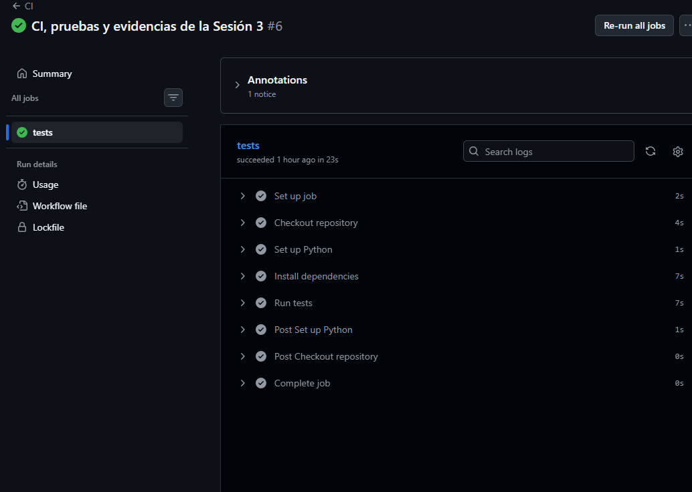
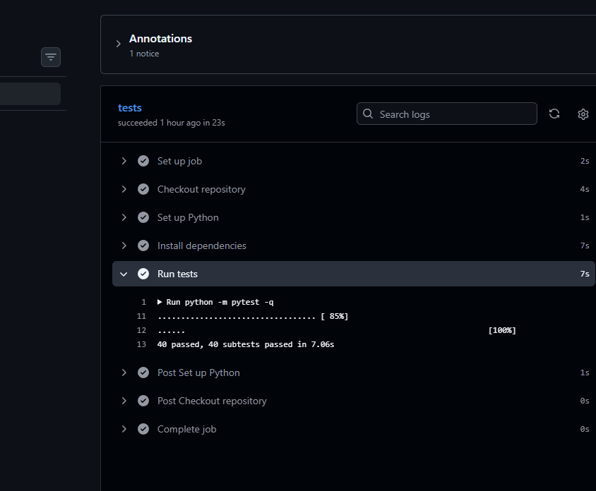
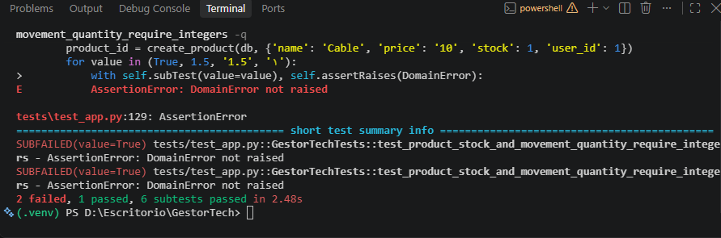
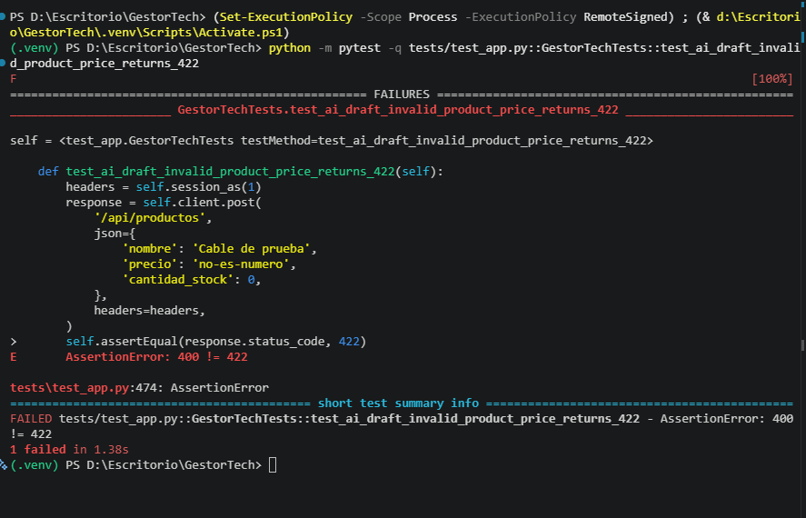
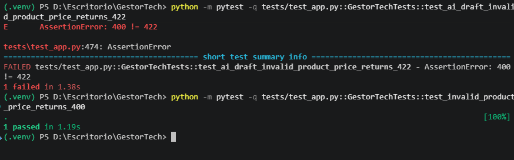

# Evidencias del proyecto GestorTech

Prueba posterior autorizada: [Groq real y Docker](verificacion_integral_2026-11-16.md#ampliación-autorizada-groq-real-y-docker), cinco casos reales finales aprobados, corrección del formato de precios y contenedor probado con login/persistencia/privilegios. Solo datos ficticios; limpieza de recursos QA verificada.

Verificación adicional 2026-11-16: [informe integral](verificacion_integral_2026-11-16.md), **155 pruebas y 77 subtests aprobados**, navegador con base ficticia, corrección de temporales y regresión del contexto por nombre. Groq real y arranque Docker pendientes.

Registro acumulativo de pruebas, integración continua y entregas académicas. Se actualizará cuando se incorporen nuevas evidencias verificadas.

## Módulo 6 · Sesión 3: pruebas e integración continua

### Suite local

El 14 de noviembre de 2026 se ejecutó `python -m pytest -q` desde el entorno virtual del proyecto. Resultado reportado en terminal: **40 pruebas aprobadas y 40 subtests aprobados**, en 50,92 segundos.

La ejecución de CI en GitHub también muestra el job `tests` en verde y el resumen de Pytest:

### Comprobación de mutación

El 15 de noviembre de 2026 se modificó temporalmente `_to_integer` para aceptar booleanos como enteros. La prueba `test_product_stock_and_movement_quantity_require_integers` detectó la regresión: fallaron los dos subtests con `True` (uno para existencias iniciales y otro para movimiento de inventario). Después se restauró la condición original y la misma prueba pasó: **1 prueba y 8 subtests aprobados**.

### Revisión de una prueba sugerida por IA

En un ejercicio de revisión, el primer borrador de IA para el endpoint `POST /api/productos` esperaba HTTP 422 ante un precio inválido. La ejecución dirigida mostró HTTP 400 (`400 != 422`), que es el código que usa el controlador Flask al convertir el error de dominio. Se corrigió la prueba a `test_invalid_product_price_returns_400`; el usuario ejecutó la prueba corregida y obtuvo **1 passed en 1,19 s**.

Este fue un ejercicio controlado: se preparó una expectativa HTTP 422 para contrastarla con el contrato HTTP 400 ya conocido. Las ejecuciones roja y verde fueron reales; no se presenta como un error espontáneo del modelo ni como un defecto del endpoint.

### Integración continua

- Workflow: `.github/workflows/ci.yml`.
- Python: 3.11; dependencias instaladas desde `requirements.txt`; ejecución `python -m pytest -q`.
- Eventos: `push` y `pull_request`.
- No requiere secretos ni realiza llamadas al proveedor de IA.
- Ejecución verificada en `push`: [GitHub Actions run 43757548979](https://github.com/LzMauLz/Proyecto-GestorT/actions/runs/43757548979), resultado **success**.
- Pull Request [#24](https://github.com/LzMauLz/Proyecto-GestorT/pull/24), abierto hacia `develop` para revisión; no fusionado.
- Ejecución verificada en `pull_request`: [GitHub Actions run 43768715477](https://github.com/LzMauLz/Proyecto-GestorT/actions/runs/43768715477), resultado **success**.

## Historial

### 2026-11-16 — Tienda, imágenes y disponibilidad

Implementación `bb49c11`, [PR #31](https://github.com/LzMauLz/Proyecto-GestorT/pull/31) abierto sin merge y [CI Python 3.11 aprobado](https://github.com/LzMauLz/Proyecto-GestorT/actions/runs/44007586942). La base real no se migró por decisión expresa del usuario; la evidencia corresponde a datos ficticios.

Suite integrada local: **154 pruebas y 77 subtests aprobados en 85,85 s**, dentro de la carpeta GestorTech. Se usaron Flask/SQLite y decodificadores Pillow reales sobre datos ficticios; el proveedor del asistente se reemplazó por un doble local explícito. La prueba de recorrido completo acepta una propuesta, carga una imagen, publica, cambia disponibilidad sin alterar stock y revoca el acceso público al despublicar.

La evidencia visual y los límites de operación local se conservan en [tienda_y_catalogo.md](tienda_y_catalogo.md), [catalogo-imagenes.md](catalogo-imagenes.md) y [operacion_demo_local.md](operacion_demo_local.md). Las imágenes de demostración de las capturas no pertenecen al inventario real.

### 2026-11-15 — Ampliación de los issues #5, #10, #12, #7, #14 y #15

La implementación combinada pasó **131 pruebas y 77 subtests en 65,75 s** en el runtime local complementario Python 3.12.14. GitHub Actions con Python 3.11 confirmó el resultado del código `0b4f44a`: [ejecución 43777915059](https://github.com/LzMauLz/Proyecto-GestorT/actions/runs/43777915059).

| Alcance | Registro |
|---|---|
| Asignación, unicidad por categoría y migración segura | [Issue #5](issues/5-integridad.md) |
| Catálogo público y publicación administrativa | [Issue #10](issues/10-catalogo.md) |
| Límites, transacciones, errores y respaldo/restauración | [Issue #12](issues/12-seguridad.md) |
| Asistente con aclaración, edición y carga local | [Issue #7](issues/7-asistente.md) |
| Navegador real en 375/768/1440 px y capturas | [Issue #14](issues/14-interfaz.md) |
| Matriz de aceptación y pruebas cruzadas | [Issue #15](issues/15-pruebas-ci.md) |

Se usaron bases SQLite temporales y datos ficticios. Los dobles explícitos del proveedor prueban el contrato local; no acreditan comprensión real de Groq. Los cambios siguen como propuestas sin merge; la creación de nuevos PR y el movimiento de Projects todavía no se han realizado.

Añadir aquí futuras pruebas, capturas, resultados de Actions y enlaces a Pull Requests, indicando fecha y resultado observado. No registrar secretos ni datos reales de clientes.
