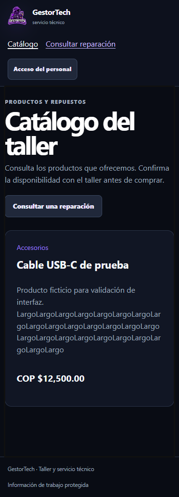
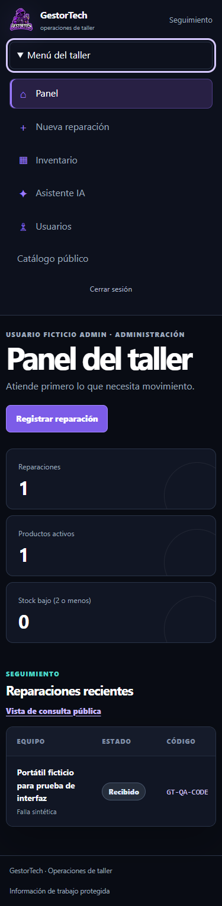
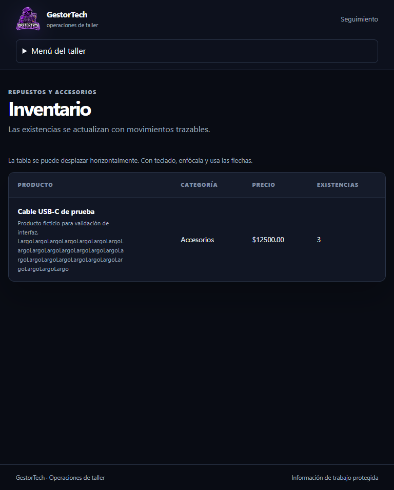
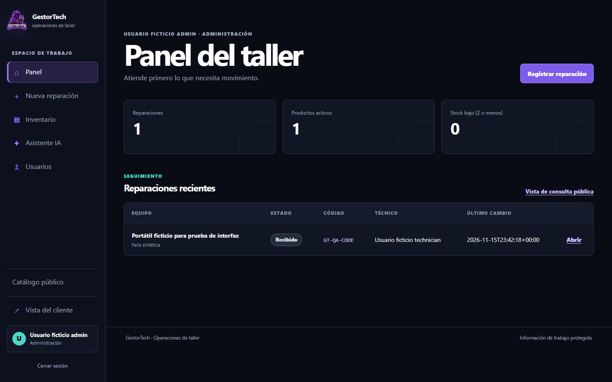
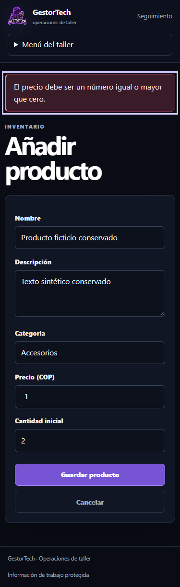

# Issue #14: navegación, formularios y validación visual

## Cambios

- La navegación del personal permanece disponible en móvil y tablet mediante un menú nativo `details/summary`, operable con teclado. Reutiliza los enlaces y condiciones de rol del escritorio e incluye cierre de sesión con CSRF.
- La navegación pública mantiene Catálogo, Seguimiento y Acceso del personal en pantallas estrechas, con ajuste de líneas y estado de página actual.
- Las tablas de inventario e importación tienen nombre de región, foco por teclado, encabezados semánticos y ayuda para desplazamiento horizontal. El dashboard mantiene su región accesible.
- Los formularios de alta/edición de productos, creación de usuario y login conservan campos no secretos tras rechazo del backend. Las contraseñas permanecen vacías. Los mensajes de error reciben foco y están asociados al formulario; seguimiento conserva el código y relaciona ayuda/error con el campo.
- Se ajustaron textos secundarios y el hover del botón principal para mejorar contraste. Los controles pequeños conservan un área vertical de 44 px en móvil/tablet; las cadenas largas no desbordan la pantalla.
- `prefers-reduced-motion` elimina transiciones/animaciones y el desplazamiento del botón al hacer hover. La mascota local conserva `object-fit: contain` y su archivo original.

## Verificación observada

Se ejecutó Chromium de Microsoft Edge en modo headless con Playwright disponible en el entorno de herramientas. Se usó un perfil nuevo, un servidor Flask de prueba en loopback, SQLite temporal, usuarios y productos ficticios y Groq desactivado. Las solicitudes del navegador a destinos externos se bloquearon.

| Comprobación | 375 px | 768 px | 1440 px |
|---|---|---|---|
| Catálogo, seguimiento, login, dashboard e inventario sin overflow del documento | PASS | PASS | PASS |
| Navegación admin/técnico y acceso por rol en la interfaz | PASS | PASS | PASS |
| Salto al contenido, menú por teclado y foco visible | PASS | PASS | PASS |
| Desplazamiento de tabla mediante flechas cuando hay overflow interno | PASS | PASS | PASS |
| Error de login/producto/edición/usuario: conservación de datos no secretos | PASS | PASS | PASS |
| Contraseñas vacías después del error | PASS | PASS | PASS |
| Importación CSV sintética: vista previa con región y encabezados accesibles | PASS | PASS | PASS |
| Seguimiento inválido: código conservado y error asociado | PASS | PASS | PASS |
| Movimiento reducido y ausencia de errores JavaScript no capturados | PASS | PASS | PASS |

También se verificó en navegador la despublicación/publicación del producto ficticio y el estado vacío del catálogo.

La suite de regresión de esta base pasó: **46 pruebas y 40 subtests en 32,88 s**, con `python -B -m pytest -q -p no:cacheprovider`. La ejecución local utilizó Python 3.12.14 incluido en el entorno de herramientas con las dependencias existentes del proyecto; el stack aprobado sigue siendo Python 3.11 y su verificación corresponde a CI.

Se midieron colores computados del navegador mediante luminancia relativa: botón principal **4,61:1**, hover **5,28:1**, encabezados de tabla **5,06:1**, pie **8,15:1**, etiqueta lateral **7,85:1** y pasos pendientes **7,52:1**. Valores completos en [contraste.json](../evidencias/issue-14/contraste.json). Estas mediciones cubren los pares seleccionados, no certifican toda la interfaz.

## Capturas

## Alcance y pendientes de integración

La validación se realizó sobre la base que incluye catálogo. El asistente se inspeccionó en su estado desactivado; la vista nueva del issue #7 debe volver a comprobarse después de integrarla con este cambio. El formulario de reparación del issue #5 se integra por separado para conservar su selección obligatoria de técnico.

No se verificaron lectores de pantalla, dispositivos físicos ni todos los pares de contraste. No se instalaron paquetes, se leyó `.env` ni se conectó Groq. El navegador de prueba y los datos temporales no usan la sesión del usuario.
