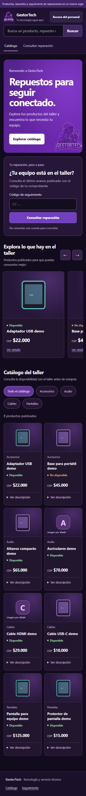
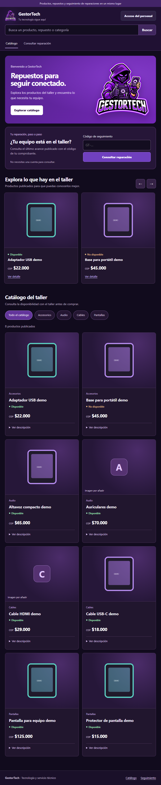
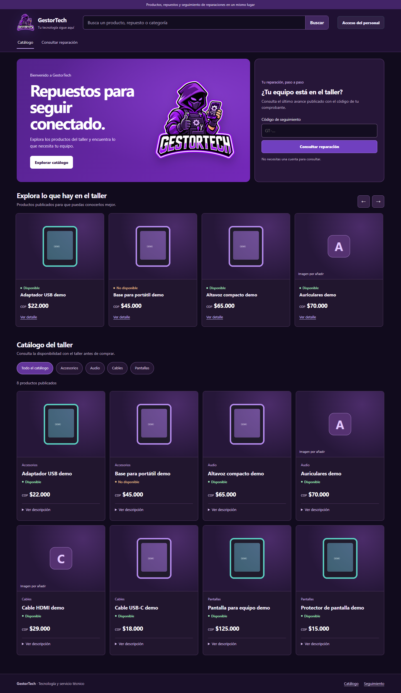
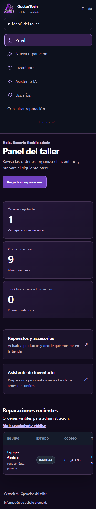
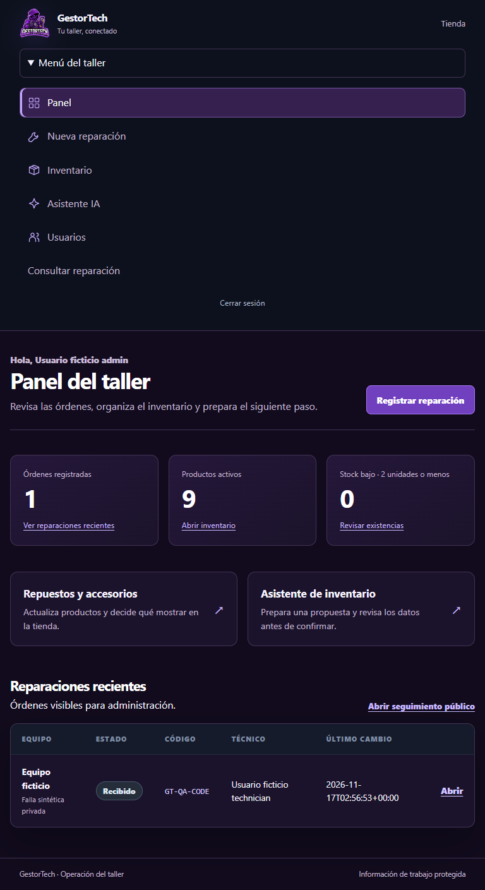
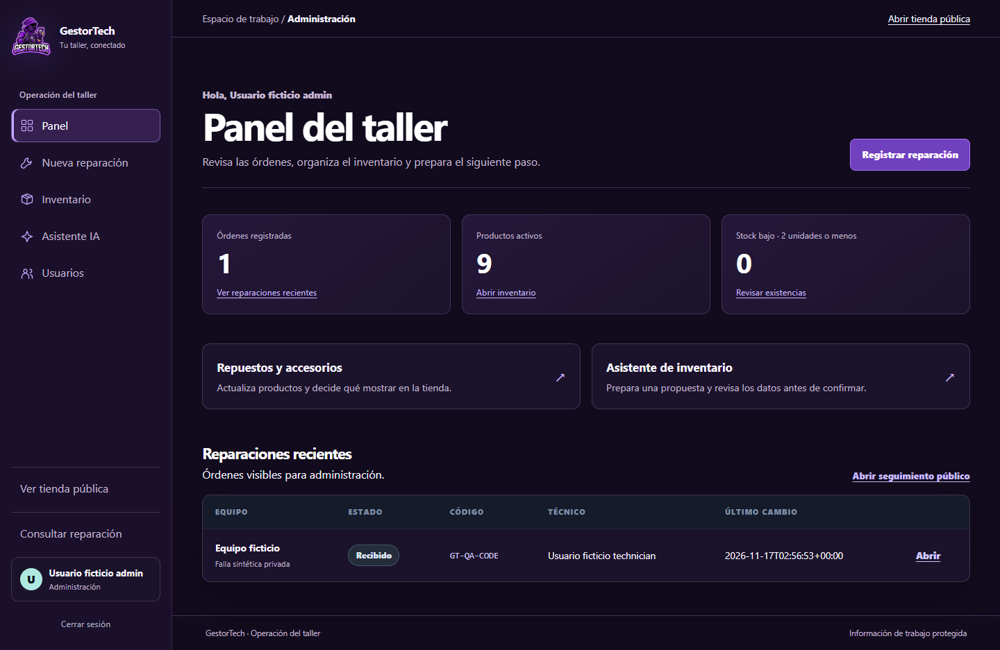

# Tienda y panel GestorTech: revisión visual integrada

## Diseño y comportamiento

La tienda usa una jerarquía de marketplace con identidad propia Gaming Premium: encabezado de búsqueda, presentación violeta con la mascota oficial, consulta de reparaciones, carrusel manual y catálogo en cuadrícula. La referencia externa orienta la distribución; no se copiaron marca, textos ni recursos gráficos de terceros. El archivo original de la mascota se conserva.

- La búsqueda filtra realmente los productos publicados por nombre, descripción y categoría. Los chips se generan desde categorías presentes; el contador anuncia resultados y el estado sin coincidencias permite limpiar filtros.
- El carrusel usa productos publicados reales. Sus botones anterior/siguiente desplazan la lista y se deshabilitan en los extremos. No tiene reproducción automática; respeta movimiento reducido y permite desplazamiento nativo con teclado/tacto.
- Cada ficha presenta nombre, categoría, precio COP sin pérdida de centavos y disponibilidad comercial. Las imágenes provienen del endpoint local autorizado; sin imagen se muestra un bloque tipográfico rotulado como imagen pendiente.
- La disponibilidad se expresa con texto además de color. No se muestran cantidades de inventario, costos, movimientos ni datos administrativos en el catálogo.
- La consulta por código es un formulario real POST hacia seguimiento, con CSRF. El catálogo puede verse sin cuenta y conserva su presentación pública cuando lo abre personal autenticado.
- El panel del taller conserva métricas suministradas por el backend. Sus accesos abren reparaciones, inventario y asistente; no se añadieron métricas ficticias ni un checkout de compra inexistente.
- La navegación del personal mantiene permisos por rol, menú móvil accesible y logout protegido.

## Evidencia de navegador

Se verificó la aplicación Flask real en loopback con Edge/Chromium headless y un perfil temporal nuevo. La base y el almacenamiento de imágenes se crearon en un directorio temporal con datos ficticios. Las imágenes DEMO de las capturas son fixtures de prueba raster, no productos incorporados al inventario del usuario. Groq permaneció desactivado y se bloquearon solicitudes externas del navegador.

| Verificación | Resultado |
|---|---|
| Catálogo en 375, 768 y 1440 px sin overflow del documento | PASS |
| Imágenes locales decodificadas, placeholder y disponibilidad visible | PASS |
| Búsqueda, categoría, cero resultados y restablecimiento | PASS |
| Carrusel manual anterior/siguiente | PASS |
| Consulta real por código con CSRF; ausencia de información privada | PASS |
| Panel admin en tres anchos; técnico sin enlace de administración de usuarios | PASS |
| Salto al contenido, foco de búsqueda, chips/carrusel/details por teclado | PASS |
| Movimiento reducido sin transiciones y sin errores JavaScript no capturados | PASS |

El informe [contraste.json](../evidencias/tienda/contraste.json) conserva los colores computados y relaciones medidas. Los 13 pares de texto revisados en el DOM obtuvieron entre **6,61:1 y 17,48:1**. El texto del hero también se contrastó conservadoramente contra el stop más claro declarado en su gradiente: **5,13:1**. Estas mediciones cubren los pares seleccionados; no equivalen a una certificación integral de accesibilidad.

## Límites

La búsqueda pública filtra en el navegador los productos ya publicados en la página; sin JavaScript se puede recorrer el catálogo completo. No se instalaron frameworks ni se incorporaron recursos remotos al frontend. No se validaron dispositivos físicos ni lectores de pantalla, y no se consultó la base real del taller.
