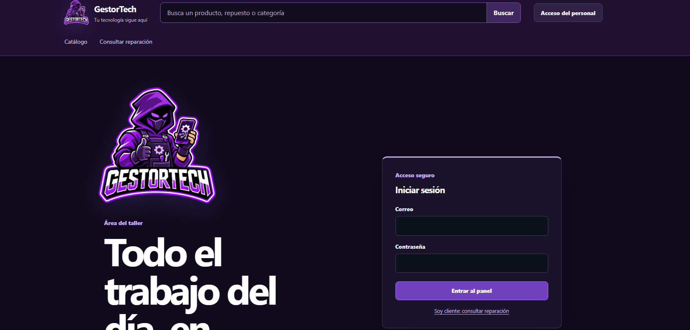
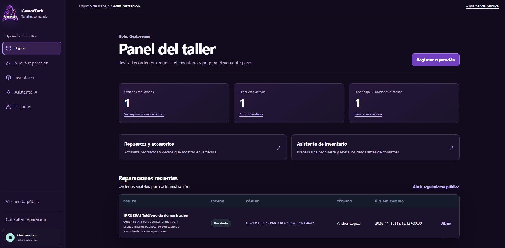
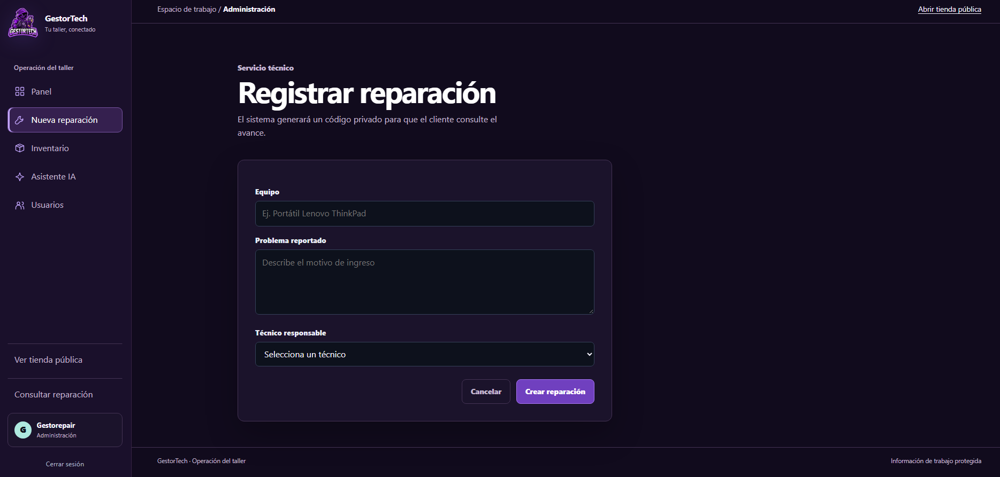
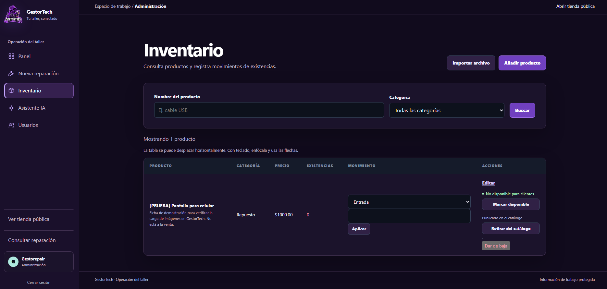
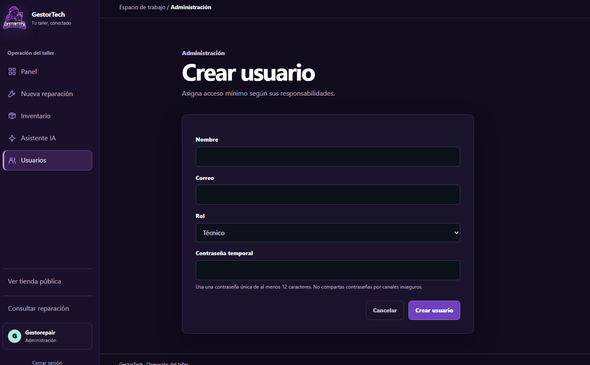
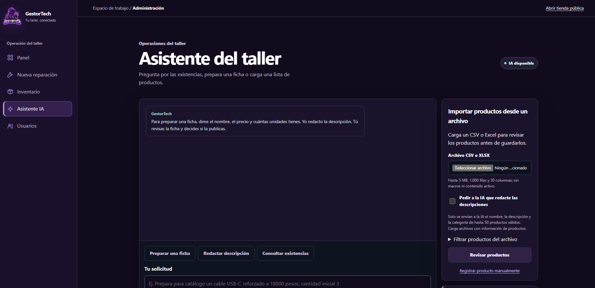

# Manual de uso de GestorTech

Usa la [demo pública](https://gestortech.pythonanywhere.com/). Para prácticas y sustentaciones, utiliza productos, usuarios y órdenes ficticias. Las capturas ilustran las pantallas, los nombres y registros de ejemplo que aparecen son demostrativos.

## Cliente

### Explorar productos

Abre el [catálogo](https://gestortech.pythonanywhere.com/catalog). Escribe el nombre o una característica del producto y pulsa **Buscar** o Intro. Puedes elegir una categoría y pulsar **Ver solo disponibles**. Copia la dirección si quieres compartir esos resultados. **Limpiar filtros** muestra el catálogo completo. Abre **Ver descripción** en una ficha para leer más sobre el producto.

En el celular, encontrarás los filtros y los productos debajo del buscador. Pulsa **Ver destacados** para saltar al carrusel. Usa **Consultar reparación** en la navegación superior para entrar al formulario de seguimiento.

### Ver una ficha y buscar por modelo

1. Abre la ficha de un producto para ver su precio, disponibilidad y compatibilidad. Si tiene una foto, puedes abrirla en tamaño completo.
2. En **Consultar al taller** encontrarás la referencia y el nombre que identifican el repuesto.
3. En **Buscar por modelo**, introduce el modelo de tu equipo y, si la conoces, la marca. Si aparecen variantes como 4G y 5G, elige la que figura en tu equipo.
4. Si está disponible la búsqueda con IA, puedes escribir una pregunta breve como «¿Qué repuestos tienen para Samsung Galaxy A15 5G?». Escribe solo información del equipo, ya que la pregunta se envía a Groq para interpretar el modelo. Si la IA no responde o alcanza su límite, usa la búsqueda manual.

La búsqueda devuelve repuestos disponibles con compatibilidad registrada para el modelo elegido. Si una ficha indica que su compatibilidad está por confirmar, consulta al taller con la referencia del producto.

### Consultar una reparación

1. Abre [Consultar reparación](https://gestortech.pythonanywhere.com/track).
2. Escribe el código `GT-` completo que te entregó el taller y pulsa **Ver estado**.
3. Consulta el estado actual y los avances publicados. No necesitas una cuenta.
4. Si no aparece, revisa que el código esté completo y pide al taller que lo confirme.

## Personal del taller

Inicia sesión desde [Acceso del personal](https://gestortech.pythonanywhere.com/login) con la cuenta que creó el administrador. No compartas tu contraseña. Si no puedes ingresar, contacta a la persona administradora.

### Buscar una reparación

1. Abre **Reparaciones** en el menú del taller.
2. Escribe el equipo o el código de seguimiento. Puedes filtrar por estado. Administración también puede elegir un técnico.
3. Usa **Pendientes** para ver las órdenes en proceso o **Listas para entregar** para ver las que ya pueden retirarse. También puedes cambiar de página con los filtros activos.
4. Pulsa el nombre del equipo para consultar el historial y registrar un avance. Si atiendes como técnico, verás las órdenes asignadas a tu cuenta.

### Administrador

- **Panel:** revisa órdenes recientes, productos y alertas de existencias. **Revisar existencias** abre los productos activos con dos unidades o menos.
- **Crear reparación:** completa el equipo y el problema, asigna un técnico activo y pulsa **Crear reparación**. Comparte con el cliente el código que aparece al terminar.
- **Actualizar reparación:** selecciona una transición disponible. Escribe en el avance público solo información que el cliente pueda ver. Reserva las notas internas para el taller.
- **Inventario:** busca por nombre o categoría. Desde **Añadir producto** completa nombre, descripción, categoría, precio y existencias. Puedes adjuntar imágenes PNG, JPEG o WebP de hasta 2 MB y 12 megapíxeles. Guarda el producto en el inventario y publícalo cuando corresponda. También puedes cambiar su disponibilidad o retirarlo del catálogo.
- Desde la edición del producto, abre **Editar modelos compatibles**. Añade una línea por modelo en el formato `Marca | Modelo`. Por ejemplo, `Samsung | Galaxy A15 5G`. Incluye solo modelos que el taller haya verificado y pulsa **Guardar modelos**.
- **Movimientos:** registra entradas o salidas desde el producto. Al aplicar el movimiento vuelves a la lista con los mismos filtros. Si la última página quedó vacía, verás la anterior. El sistema impide dejar existencias negativas.
- **Usuarios:** crea cuentas del personal y asigna el rol adecuado. Crea un técnico activo antes de registrar reparaciones que deban asignarse.

### Técnico

- Entra a **Reparaciones** para buscar entre las órdenes asignadas a tu cuenta. El **Panel** sigue mostrando las más recientes.
- Abre una reparación y guarda el siguiente estado permitido.
- Usa el avance público únicamente para información destinada al cliente.
- La publicación de productos, la gestión de existencias y la aprobación de propuestas de catálogo corresponden al administrador.

## Asistente de IA e importaciones

En **Asistente IA**, escribe una solicitud sencilla. Por ejemplo, pide redactar una descripción para un producto indicando su nombre y categoría, o consulta las existencias de un producto. Para crear una propuesta de catálogo, revisa nombre, descripción, categoría, precio y cantidad antes de aprobarla. Adjunta la imagen en el flujo de creación y confirma la publicación manualmente.

Para importar CSV o XLSX, selecciona el archivo, revisa la vista previa y las filas detectadas, y aprueba explícitamente qué guardar. Las sugerencias de IA son opcionales. Si la IA no está disponible, usa el formulario manual de inventario. No incluyas información personal de clientes en archivos enviados para análisis de IA.

La IA puede equivocarse. Verifica siempre la descripción y los demás campos. No aceptes valores que no estén respaldados por la información del producto.

Consulta también [capacidades y privacidad de IA](uso_ia.md), [operación de la demo](entrega_funcional.md) y [requisitos del proyecto](requisitos.md).
