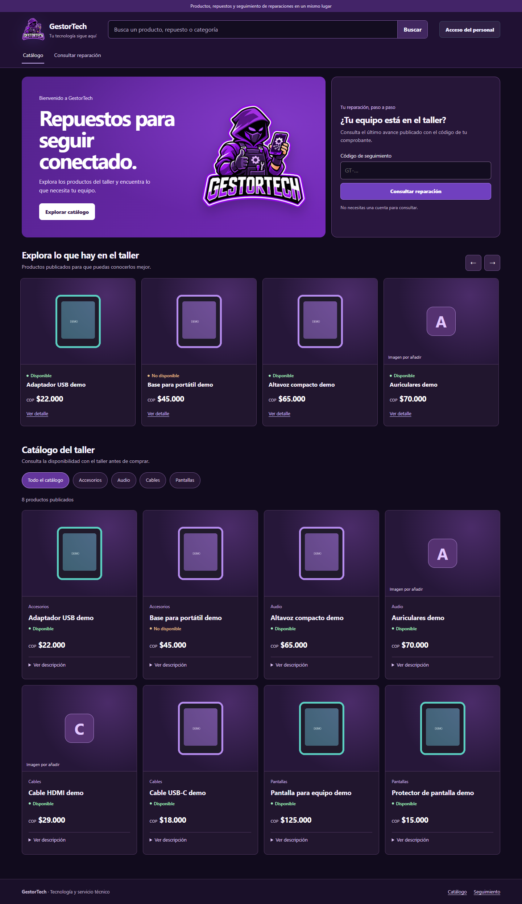
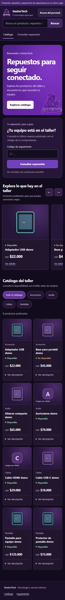
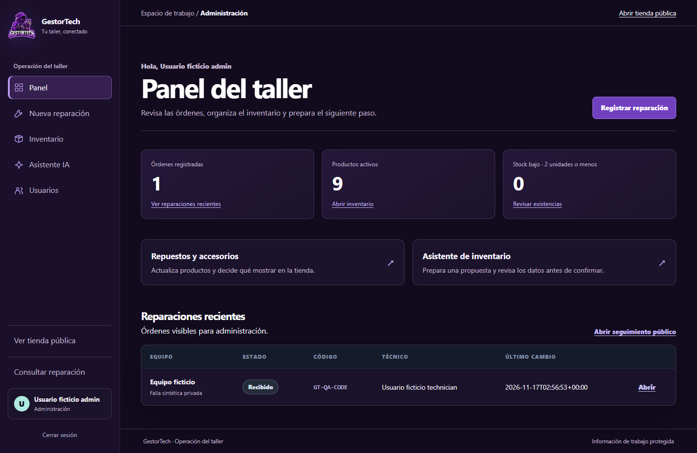
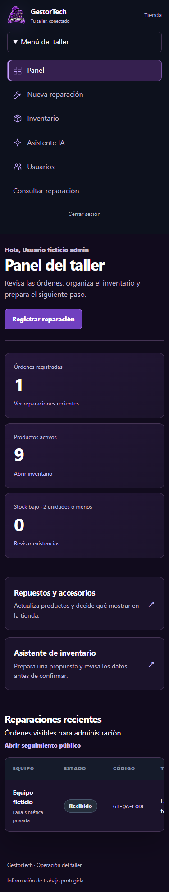

# Tienda, catálogo y revisión administrativa

Entrega del 2026-11-16 implementada en la carpeta `D:\Escritorio\GestorTech`. La rama `feat/tienda-catalogo-imagenes` reúne la ampliación posterior a los seis PR anteriores. No se han fusionado esos PR durante este trabajo.

## Experiencia pública

La entrada anónima dirige a una tienda pública con buscador por nombre/descripción/categoría, filtros de categorías reales, carrusel manual de productos publicados y fichas con imagen, precio y disponibilidad comercial. El carrusel no se reproduce automáticamente; conserva controles de teclado y respeta movimiento reducido. La consulta de reparación está presente como formulario con código y CSRF y conserva el filtrado de notas internas.

La referencia de estructura comercial fue [Eneba](https://www.eneba.com/); no se copiaron su marca, textos ni imágenes. Se conserva la mascota y paleta violeta de GestorTech. No se añadieron pagos, carrito o descuentos ficticios.

## Administración y técnicos

Solo administración puede crear o editar productos, adjuntar/reemplazar imágenes, cambiar disponibilidad y publicar/despublicar. El técnico puede consultar inventario y trabajar sobre reparaciones asignadas; ocultar botones no sustituye las comprobaciones del servidor.

El dashboard muestra sus métricas existentes y atajos para inventario, asistente, reparaciones y tienda. Las métricas proceden de SQLite, sin datos decorativos. La navegación móvil conserva enlaces por rol y cierre de sesión.

## Asistente y alternativa manual

1. Administración proporciona nombre, descripción, precio y cantidad inicial para preparar una propuesta. Si falta cantidad, se solicita; cero solo se admite cuando se indica explícitamente.
2. La propuesta se puede revisar, editar, aceptar o cancelar. Cancelar no crea un producto.
3. Aceptar crea el producto sin publicarlo. Se muestra un enlace para adjuntar la imagen local y revisar su ficha.
4. En la edición, se puede adjuntar PNG/JPEG/WebP y marcar Disponible/No disponible. Guardar no publica automáticamente.
5. Desde Inventario, la administración publica la ficha revisada. Una ficha publicada pero no disponible conserva su información pública y muestra ese estado; no se expone el stock exacto.

Con IA desactivada o fallida, Inventario → Añadir producto ofrece los mismos campos y carga de imagen, sin dependencia del proveedor. Las imágenes no se envían al modelo: el asistente es útil redactando/estructurando la información textual y haciendo preguntas, mientras el formulario local incorpora el recurso visual. Se conserva puerto/adaptador y revisión humana.

## Seguridad y operación

Pillow 13.0.0 se aprobó e instaló en `.venv-review` dentro del proyecto. [Auditoría de la dependencia](auditoria_pillow.md). [Límites y rutas de las imágenes](catalogo-imagenes.md). [Operación local y respaldo de SQLite junto a imágenes](operacion_demo_local.md).

El alcance de #12 fue confirmado como **demostración local**. Los controles de la aplicación, carga de imágenes, backup y restauración se verifican con datos ficticios. TLS, WSGI y política de operación pública quedan reservados a una fase de despliegue; no se afirma que Internet esté aprobado.

El #7 queda implementado para este flujo y probado localmente; no se probó comprensión semántica de Groq real ni se introdujeron credenciales. La validación con un proveedor de prueba explícito verifica el contrato, permisos y persistencia de la aplicación.

## Pruebas automatizadas de esta ampliación

CI Python 3.11 observado para el commit de implementación `bb49c11`: [44007586942 — success](https://github.com/LzMauLz/Proyecto-GestorT/actions/runs/44007586942). Solicitud de revisión: [PR #31](https://github.com/LzMauLz/Proyecto-GestorT/pull/31), sin merge, base `test/issue-15`.

El usuario rechazó la migración de su base existente para dejar sus datos intactos. La migración aditiva está preparada y probada con fixtures; no está aplicada sobre los datos del taller. No se debe iniciar la nueva versión sobre una base antigua sin actualizar su esquema con respaldo y autorización.

Suite completa ejecutada en la carpeta real de GestorTech con `.venv-review/Scripts/python.exe -B -m pytest -q -p no:cacheprovider`: **154 passed, 77 subtests passed en 85,85 s**. Python local complementario 3.12.14; Flask 3.1.3, pytest 9.1.1, openpyxl 3.1.5 y Pillow 13.0.0. `pip check` no encontró dependencias rotas. GitHub Actions verificará Python 3.11 con el mismo `requirements.txt`.

Los archivos nuevos `tests/test_storefront_media.py`, `tests/test_catalog_assistant.py`, `tests/test_storefront_journey.py` y `tests/test_local_demo_policy.py` comprueban decodificación real, rechazo de contenido inválido, permisos, privacidad de imágenes, cancelación, aprobación y paso a carga de imagen, publicación/despublicación y disponibilidad independiente del stock. Las bases e imágenes se generan en directorios temporales. El proveedor de la prueba del asistente es un doble explícito, sin tráfico externo.

## Evidencia visual

Informe y mediciones: [revisión de tienda y panel](issues/14-tienda-redisenio.md). El banner se ajustó tras medir contraste; el límite conservador del punto más claro final alcanza 5,13:1 con su texto. Estas mediciones de pares seleccionados no certifican toda la interfaz ni sustituyen una revisión con lectores de pantalla.

Edge/Chromium real, perfil temporal nuevo, servidor loopback y base e imágenes ficticias. Verificación de tienda en 375/768/1440 px: carga de imágenes, privacidad de producto oculto, disponibilidad, búsqueda/no coincidencias, filtros, carrusel y envío real de seguimiento con CSRF. Panel por roles, menú móvil, logout, sin errores JavaScript ni desbordamiento horizontal.

Se detectó y corrigió un desbordamiento causado por etiquetas accesibles dentro del carrusel: se asignó un contexto de posición a sus contenedores. El formato de precios se presenta en español de Colombia y conserva centavos calculados con enteros.

Las imágenes de productos que aparecen en estas capturas son fixtures gráficos identificados como DEMO, no datos del inventario del taller.
